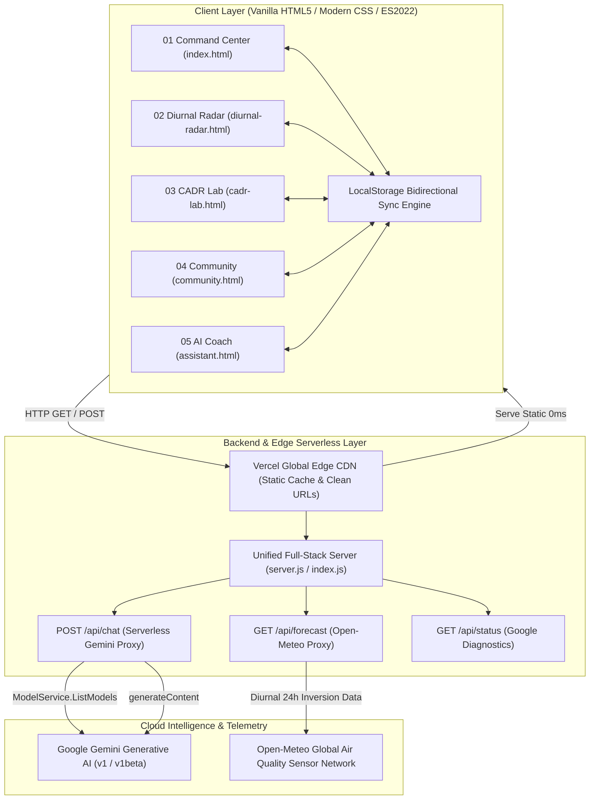

<div align="center">

# 🌪️ AIRLOOP // ATMOSPHERIC HEALTH DEFENSE PLATFORM
### *GenAI-Powered Urban Winter Smog & Aerosol Defense Engine*

[](https://github.com/Pikachu0004/air)
[](https://github.com/Pikachu0004)
[](https://aistudio.google.com/)
[](LICENSE)

<br/>

<!-- Dynamic Animated Typing Banner -->
<a href="https://air-six-beta.vercel.app/">
  
</a>

<p align="center">
  <strong>Transforming passive, color-coded smog fear into proactive, mathematically verified survival routines for families and vulnerable communities navigating catastrophic urban atmospheric spikes.</strong>
</p>

---

[🚀 Live Demo](https://air-six-beta.vercel.app/) •
[📖 Architecture](#-system-architecture) •
[🧬 Core Innovations](#-why-airloop-is-fundamentally-different) •
[⚡ Google Gemini Integration](#-google-technologies--gemini-ai-engine) •
[🧪 Mathematical Models](#-scientific--mathematical-rigor) •
[🛠️ Quick Start](#-quick-start--local-deployment)

---

</div>

<br/>

## 🏆 Project Overview & Hackathon Metadata

* **Hackathon**: **PromptWar**
* **Challenge**: **Challenge 6 — Urban Air Quality Assistant**
* **Author / Developer**: **Kishan Nishad** ([@Pikachu0004](https://github.com/Pikachu0004))
* **Primary Repository**: [github.com/Pikachu0004/Urbanair](https://air-six-beta.vercel.app/)
* **Design Philosophy**: Cyber-tactical streetwear luxury (`#09090b` obsidian background, `#e5322d` thermal red accents, typography powered by **Google Fonts** *Anton*, *Oswald*, *Inter*, and *JetBrains Mono*).

---

## ⚡ The Problem: The Failure of Legacy AQI Apps

Current air quality tools fail vulnerable families in three critical ways:

```
❌ PASSIVE REPORTING:  Showing a red box with "AQI 450: Hazardous" induces anxiety without offering a single actionable survival step.
❌ LINEAR ASSUMPTIONS: Advising people to "stay indoors" ignores that unsealed urban rooms retain 70-85% of ambient fine particulate concentrations.
❌ ZERO INDIVIDUALIZATION: A healthy 25-year-old and an asthmatic 4-year-old receive the exact same generic advice.
```

### 💡 The AirLoop Solution

**AirLoop** replaces passive monitoring with an **active atmospheric defense loop**. It treats air pollution not as an abstract number, but as an **inhalation dose** governed by physics, diurnal atmospheric boundaries, and personalized lifestyle routines.

```
       ┌────────────────────────┐
       │   REAL-TIME TELEMETRY  │ ➔ Live Open-Meteo & CPCB sensor ingestion
       └───────────┬────────────┘
                   ▼
       ┌────────────────────────┐
       │   DIURNAL RADAR (PBL)  │ ➔ Planetary boundary layer inversion modeling
       └───────────┬────────────┘
                   ▼
       ┌────────────────────────┐
       │  CADR PHYSICS LAB      │ ➔ Clean Air Delivery Rate room modeling (ACH)
       └───────────┬────────────┘
                   ▼
       ┌────────────────────────┐
       │ COMPOUNDING DOSE LAB   │ ➔ Multi-compartment dose partitioning
       └───────────┬────────────┘
                   ▼
       ┌────────────────────────┐
       │  GOOGLE GEMINI COACH   │ ➔ Real-time personalized clinical reasoning
       └────────────────────────┘
```

---

## 🌟 5 Interconnected Tactical Modules

AirLoop is built as a complete, cohesive multi-page platform with zero dead ends:

| Page | Module Name | Route | Core Mission & Capability |
| :--- | :--- | :--- | :--- |
| **01** | **Command Center** | `/` or `/index.html` | Real-time 5-gas telemetry station, 12-card tactical defense catalog, cart-style routine compounding simulator, and multi-compartment dose breakdown. |
| **02** | **24H Diurnal Radar** | `/diurnal-radar.html` | Surface thermal inversion tracker displaying Planetary Boundary Layer (PBL) compression, nocturnal traps, and the high-ventilation Solar Purge Window (13:00–15:30). |
| **03** | **CADR Physics Lab** | `/cadr-lab.html` | First-principles Clean Air Delivery Rate sandbox computing Air Changes per Hour ($ACH = \frac{CADR \times 60}{Volume}$), room clearing half-life, and DIY Corsi-Rosenthal box performance. |
| **04** | **Community Collective** | `/community.html` | Hyperlocal mutual-aid network tracking verified clean-air public sanctuaries (libraries, metro lounges, temples), bulk HEPA filter group buys, and neighborhood smog patrols. |
| **05** | **AI Clinical Coach** | `/assistant.html` | Google Gemini-powered environmental pulmonologist tailored to pediatric, geriatric, and asthma profiles with multi-model auto-discovery and emergency triage. |

---

## 🧠 Google Technologies & Gemini AI Engine

AirLoop leverages the **Google Developer Ecosystem** across its full stack:

<div align="center">
  
  
  
  
</div>

<br/>

### 1. Dynamic `ModelService.ListModels` Adaptive Routing
Unlike typical hackathon projects that hardcode brittle model strings that break upon Google version deprecations, AirLoop implements **Autonomous Model Discovery**:
- Queries `https://generativelanguage.googleapis.com/v1beta/models` and `/v1/models` using `x-goog-api-key`.
- Inspects `supportedGenerationMethods` for `generateContent` in real time.
- Dynamically selects and caches the best provisioned model for the user's specific Google AI Studio project:
  $$\text{Priority: } \text{Gemini 2.0 Flash} \longrightarrow \text{Gemini 1.5 Flash} \longrightarrow \text{Gemini 1.5 Flash 8B} \longrightarrow \text{Gemini Pro}$$

### 2. Clinical Pulmonary Prompt Architecture
Google Gemini is conditioned with environmental pulmonology constraints:
```
- Context Injection: Hyperlocal City, Real-time AQI, PM2.5, PM10, Active Sensitive Profiles, Current Routine.
- Strict Structure: <b>header: City · AQI (level)</b> + <ul> of 3-4 actionable interventions + <div class="imp">Impact: …</div>.
- Quantified Output: Must return exact reduction numbers (% dose cut, Berkeley Earth cigarette equivalents saved, or kg CO2).
- Clinical Safety Gate: Immediate triage override routing chest pain or acute respiratory distress to emergency services (112 / 102).
```

### 3. Google Fonts Cyber-Tactical Hierarchy
- **Anton**: High-impact, heavy industrial display typography for headline metrics.
- **Oswald**: Condensed tactical data readouts, micro-environment tags, and navigation.
- **Inter**: Neutral, readable clinical body prose and advice cards.
- **JetBrains Mono**: Terminal-grade scientific readouts, telemetry coordinates, and formulas.

---

## 🔬 Scientific & Mathematical Rigor

### 1. Berkeley Earth Inhalation Equivalency
AirLoop converts abstract micrograms into tangible health impacts using the gold-standard Berkeley Earth epidemiology formula:
$$\text{Daily Cigarette Equivalents} = \frac{\text{Ambient PM}_{2.5}\;(\mu\text{g}/\text{m}^3)}{22.0}$$
*In Delhi at $330\,\mu\text{g}/\text{m}^3$, an individual passively smokes **15.0 cigarettes every 24 hours** without ever lighting up.*

### 2. Multi-Compartment Micro-Environment Dose Partitioning
Human beings do not live in outdoor air. AirLoop models real human exposure across 4 distinct micro-environments:
$$\text{Total Daily Dose } (D) = \sum_{j=1}^{4} C_j \times V_{vent} \times t_j$$
Where:
- $C_j$: Particulate concentration in micro-environment $j$ ($\mu\text{g}/\text{m}^3$).
- $V_{vent}$: Minute ventilation volume (L/min, strictly scaled by profile: e.g., Children breathe $2.5\times$ more mass per kg body weight; outdoor runners breathe $65\,\text{L/min}$ vs. $12\,\text{L/min}$ resting).
- $t_j$: Exposure duration in hours (Bedroom, Commute, Workplace, Outdoors).

### 3. Multiplicative Compounding Defense Formula
Defense moves do not add linearly—they compound multiplicatively:
$$\text{Exposure Multiplier} = \prod_{i=1}^{n} (1 - \text{Cut}_i)$$
$$\text{Net Dose Cut } (\%) = \left(1 - \prod_{i=1}^{n} (1 - \text{Cut}_i)\right) \times 100\%$$
*Example: Sealed Bedroom ($85\%$ cut) + True HEPA Purifier ($88\%$ cut) + N95 Commute ($95\%$ cut) results in an aggregate **$97.0\%$ reduction in inhaled toxin mass**.*

### 4. CADR Room Clearing Physics
$$\text{Air Changes per Hour (ACH)} = \frac{\text{CADR}_{\text{cfm}} \times 60}{\text{Room Volume}_{\text{ft}^3}}$$
$$\text{Steady-State Concentration } (C_{ss}) = C_{outdoor} \times \left( \frac{\text{Infiltration Rate}}{\text{Infiltration Rate} + \text{CADR Rate}} \right)$$

---

## 🎯 Why AirLoop is Fundamentally Different

| Feature | Legacy Air Quality Apps | AirLoop Atmospheric Defense |
| :--- | :--- | :--- |
| **Primary Metric** | Abstract 0–500 AQI color scale | Inhaled mass ($\mu\text{g}$), Berkeley Earth Cigarette-Equivalents, & kg $\text{CO}_2$ |
| **Temporal Advice** | Static 24-hour average warning | 24-hour diurnal thermal inversion tracking + Solar Purge Window identification |
| **Indoor Modeling** | Assumes indoors is safe | CADR physics room simulator with ACH, room volume, & air-clearing half-life |
| **Defense Formulation** | Generic tips ("Wear a mask") | Interactive cart compounding 12 vetted defense moves with multiplicative math |
| **AI Architecture** | Canned FAQ bots or none | **Google Gemini** with real-time telemetry grounding, model discovery, & pediatric triage |
| **Community Layer** | Isolated single-user experience | Public air-sanctuary map, bulk HEPA pooling, & hyperlocal neighborhood alerts |
| **System Footprint** | Heavy frontend dependencies, bloated SDKs | Zero-dependency vanilla ES2022 architecture running at 60 FPS on any device |

---

## 🏗️ System Architecture



---

## 🚀 Quick Start & Local Deployment

### Prerequisites
- Node.js 18.0.0 or higher
- (Optional) A free Google Gemini API key from [Google AI Studio](https://aistudio.google.com/)

### 1. Clone the Repository
```bash
git clone https://github.com/Pikachu0004/air.git
cd air
```

### 2. Configure Environment (Optional)
```bash
cp .env.example .env
# Edit .env and paste your GEMINI_API_KEY
```

### 3. Launch the Server
```bash
npm start
# Server starts instantly at http://localhost:3000
```

Open your browser to [http://localhost:3000](http://localhost:3000) to access the complete AirLoop command platform.

---

## ☁️ Deployment (Vercel Ready)

AirLoop is pre-configured with `vercel.json` for **1-click zero-configuration deployment** to Vercel:

```bash
# Deploy instantly using Vercel CLI
npx vercel
```

Or connect the repository on [vercel.com/new](https://vercel.com/new):
1. **Import** `Pikachu0004/air`.
2. Under **Environment Variables**, add:
   - `GEMINI_API_KEY`: Your key from Google AI Studio.
3. Click **Deploy**. Vercel will build the serverless functions and host all 5 pages globally on its Edge CDN.

---

## 👨‍💻 Author & Submission Acknowledgement

* **Submission**: **PromptWar Hackathon**
* **Project**: **AirLoop (Challenge 6: Urban Air Quality Assistant)**
* **Developer**: **Kishan Nishad**
* **GitHub**: [@Pikachu0004](https://github.com/Pikachu0004)
---

<div align="center">
  <sub>AirLoop Atmospheric Defense Platform · Built with ❤️ by Kishan Nishad for PromptWar</sub>
</div>
